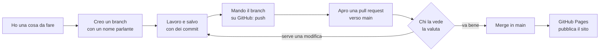
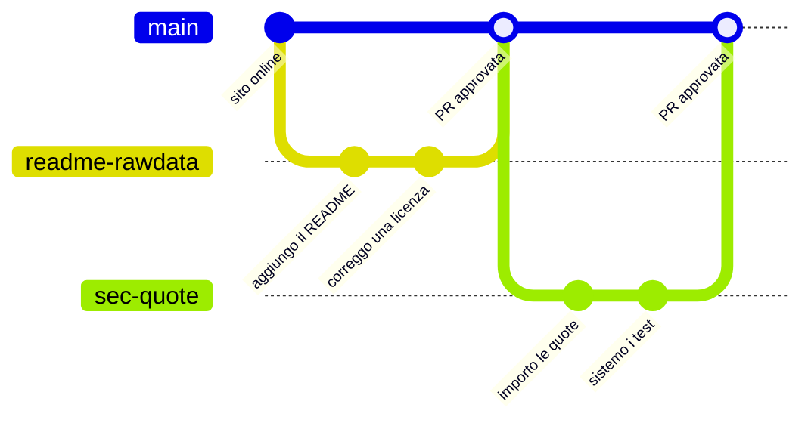
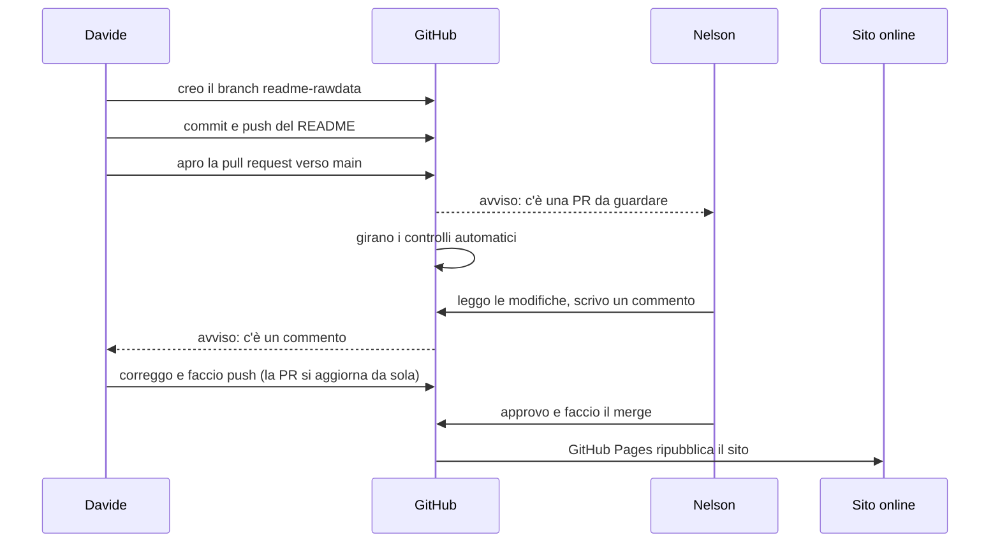
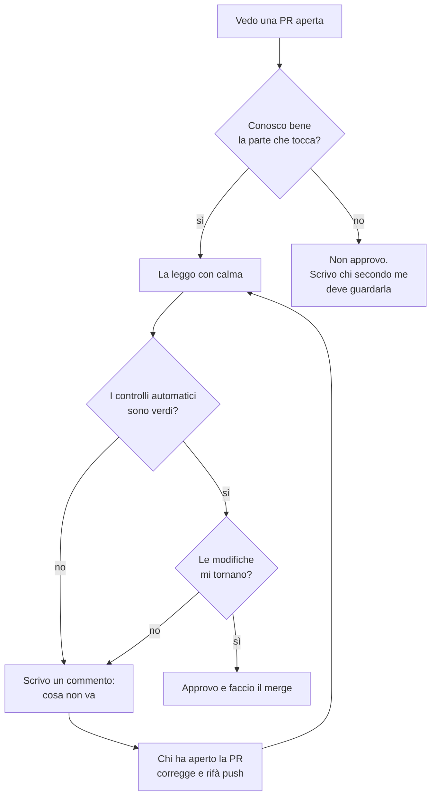
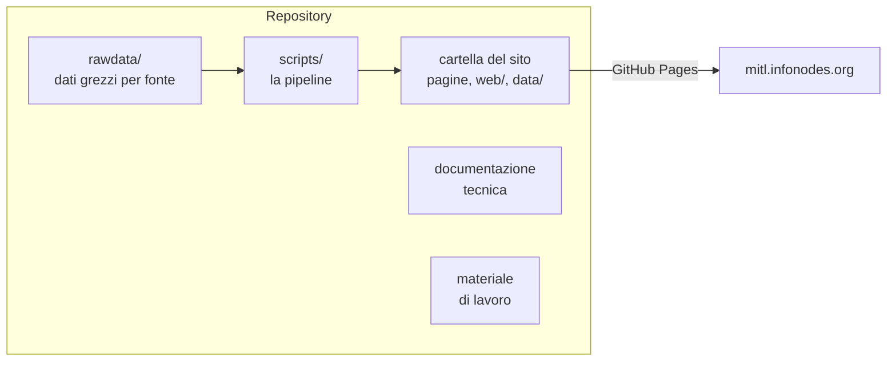

# Come si lavora a questo repository

Questo documento spiega come lavoriamo insieme sul repository di Man in the Loop. È scritto per chi non ha mai usato Git o GitHub: le regole sono poche e i disegni servono a vederle.

## Indice

1. Le quattro regole
2. Il giro completo, in un disegno
3. Le parole che servono
4. Cosa succede quando apro una pull request
5. Chi valuta una pull request
6. Cosa va online e cosa no
7. Come si fa in pratica, strumento per strumento
8. Il numero di versione
9. Vedere il sito in locale
10. Una nota sulla copia di lavoro

## 1. Le quattro regole

1. `main` è il sito. Quello che sta in `main` è quello che le persone vedono online.
2. Non si lavora mai direttamente su `main`. Ogni lavoro, anche piccolo, nasce su un branch.
3. Il lavoro entra in `main` solo con una pull request (PR).
4. La PR la valuta il primo che la vede. Se conosce bene la parte toccata la approva, altrimenti non la approva e chiede aiuto a chi la conosce.

Tutto il resto di questo documento è un modo di spiegare queste quattro righe.

## 2. Il giro completo, in un disegno



Un branch è una copia di lavoro del progetto dentro il repository stesso. Finché sto sul mio branch posso fare e disfare senza toccare il sito. Quando il lavoro è pronto chiedo di portarlo in `main`, e quello è la pull request.

Così appare la storia del progetto vista da Git: `main` va avanti dritto e ogni lavoro è una deviazione che poi rientra.



## 3. Le parole che servono

| Parola | Cosa vuol dire | Immagine |
|---|---|---|
| repository (repo) | la cartella del progetto con tutta la sua storia | l'archivio |
| `main` | il branch principale, quello pubblicato | lo scaffale «in vetrina» |
| branch | una linea di lavoro separata, con un nome | un tavolo da lavoro a parte |
| commit | un salvataggio con una frase che dice cosa ho cambiato | una pagina di diario |
| push | mandare i miei commit su GitHub | mettere il lavoro in cassaforte |
| pull request (PR) | la richiesta di portare il mio branch in `main`, con la lista delle modifiche | «guardate, è pronto, va bene?» |
| merge | l'unione del branch in `main`, quando la PR è approvata | il lavoro passa in vetrina |
| GitHub Pages | il servizio di GitHub che pubblica il sito a partire da `main` | la tipografia |

## 4. Cosa succede quando apro una pull request

Qui sotto l'esempio di Davide che aggiunge il README dei rawdata e di Nelson che valuta.



Tre cose da notare:

- la PR si aggiorna da sola a ogni push sul branch: non si apre una PR nuova per ogni correzione;
- i controlli automatici (gli script di verifica del database e del sito) girano a ogni PR e il risultato si vede nella PR stessa, con un segno verde o rosso;
- il sito cambia solo all'ultimo passo, il merge. Fino a quel momento niente di quello che faccio è online.

## 5. Chi valuta una pull request



Non c'è un'approvazione obbligatoria imposta da GitHub: la regola è nostra. Chi non si sente sicuro non approva, e non è un problema: è esattamente quello che la regola chiede.

## 6. Cosa va online e cosa no



Oggi GitHub Pages pubblica tutta la root di `main`, quindi è online tutto quello che sta in `main`. La proposta in discussione è di pubblicare solo una cartella dedicata (`docs/`), così script, dati grezzi e note restano nel repository senza finire sul sito. In entrambi i casi la regola non cambia: in `main` si entra con una PR, e quello che è in `main` è pubblico.

Le cartelle di lavoro personali (`tmp/`, `IRPI-test/`, `SEC/`, `Jon_Tassonomia/`, `inbox/`, `docs/meetings/`) sono escluse dal repository tramite `.gitignore` e non vanno committate.

## 7. Come si fa in pratica, strumento per strumento

Le regole sono le stesse, cambia solo cosa si clicca o si scrive.

### Con Claude Code (o un altro assistente AI)

Si dice all'assistente cosa si vuole, in italiano. Frasi che funzionano:

- «Crea un branch che si chiama `readme-rawdata` partendo da `main` aggiornato.»
- «Salva il lavoro con un commit e fai il push.»
- «Apri una pull request verso `main` e descrivi cosa ho cambiato.»
- «Mostrami le pull request aperte» oppure «Leggi la PR numero 12 e dimmi cosa cambia.»
- «Sono su `main`? Se sì, portami su un branch nuovo prima di toccare qualcosa.»

L'ultima frase è la più utile: la cosa da evitare è lavorare su `main` senza accorgersene.

### Con Visual Studio Code

1. In basso a sinistra c'è il nome del branch corrente. Se c'è scritto `main`, cliccarci sopra e scegliere «Create new branch» con un nome parlante.
2. Si lavora sui file. Nella barra laterale, l'icona «Source Control» mostra i file modificati.
3. Si scrive una frase nel campo del messaggio e si clicca «Commit», poi «Sync Changes» (è il push).
4. VS Code propone «Create Pull Request»: si clicca, si rilegge la descrizione, si conferma. In alternativa si apre GitHub nel browser, che mostra un bottone giallo «Compare & pull request».

### Con GitHub Desktop

1. «Current Branch» in alto: se è `main`, «New Branch» e un nome parlante.
2. Si lavora sui file con il programma che si preferisce. GitHub Desktop elenca le modifiche a sinistra.
3. Si scrive il messaggio in basso a sinistra e si clicca «Commit to <nome branch>», poi «Push origin».
4. Compare il bottone «Preview Pull Request» oppure «Create Pull Request»: si apre GitHub nel browser con la PR da confermare.

### Valutare una PR, con qualsiasi strumento

Si fa su GitHub nel browser: nella PR, la scheda «Files changed» mostra riga per riga cosa cambia. Si può commentare una riga precisa. Il bottone «Review changes» permette di approvare o di chiedere modifiche. Il merge è il bottone verde «Merge pull request» in fondo alla scheda «Conversation».

## 8. Il numero di versione

Sotto il logo, in ogni pagina, compare la versione, oggi `Prototype v.2026-b`. Lo schema è `Prototype v.ANNO-lettera`: a ogni nuova versione pubblicata si passa alla lettera successiva, l'anno cambia con l'anno solare e si riparte da `a`. La stringa è ripetuta nelle sei pagine (`index.html`, `networks.html`, `key-figures.html`, `search.html`, `publications.html`, `about.html`) e va cambiata nella PR che pubblica la nuova versione, non dopo. A ogni versione pubblicata corrisponde anche un tag Git con lo stesso nome, così si può sempre tornare a vedere com'era.

## 9. Vedere il sito in locale

Dalla cartella del repository:

```bash
python3 -m http.server 8001
```

Su Windows il comando è `py -3 -m http.server 8001`. Poi si apre `http://localhost:8001`. Non serve altro: il sito è statico e legge i file così come sono.

## 10. Una nota sulla copia di lavoro

Git non vede il lavoro che non è stato committato. Per questo la regola di fine sessione è una sola: si fa sempre commit e push, anche del lavoro a metà, su un branch. Un commit con scritto «wip: sto sistemando i selettori» è brutto ma innocuo; un pomeriggio di lavoro che sta solo sul disco no. Nelson lavora da una sola cartella su un hard disk portatile proprio per non avere due copie che divergono; per gli altri vale la regola generale: un clone per persona, e a fine sessione si pusha.
