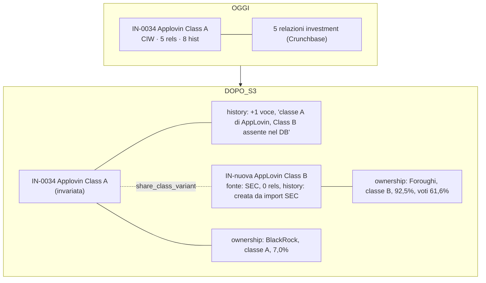
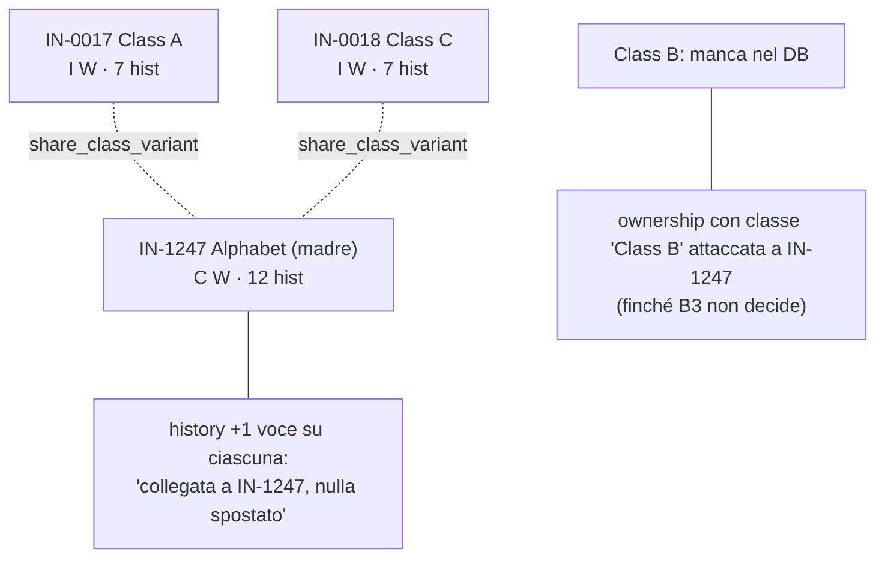
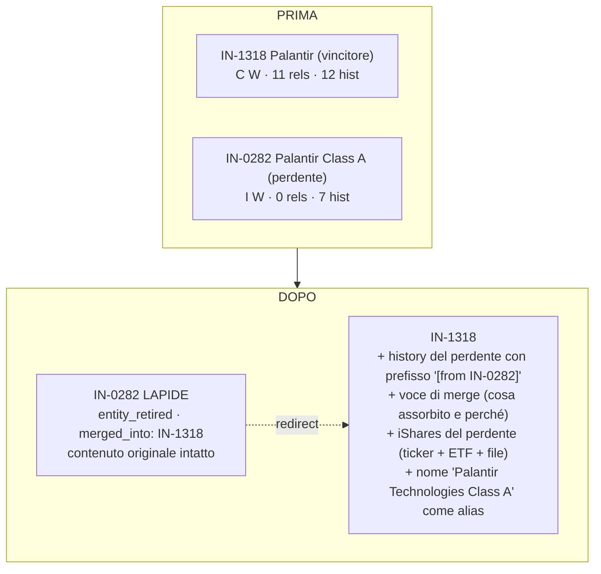

# S3 — società con più classi di azioni (decisione B1)

**Decisione S3 (Nelson, 2026-11-11): opzione (c) con le regole R1-R6 qui sotto.** Vale per tutto il lavoro SEC/`ownership` e per B3. Una regola di questo file si cambia solo con una nuova decisione registrata nel log.

## Le 22 aziende con più classi tra i detentori >5%

Fonti: release SEC 2026-10-17 (branch `v.2026-c`, `detentori-oltre-5.csv`) e `docs/data/database.json` al 2026-11-11. L'abbinamento ticker → entità è mio (per ticker iShares e per nome): le righe marcate «?» vanno confermate da una persona.
Sigle: C=crunchbase, E=edf, I=ishares, W=wikidata. rels = relazioni nel DB; hist = voci di history.

## Gruppo 1 — nel DB c'è già una sola entità per società; basta il campo `classe` (5)

| Ticker | Società | Classi nel SEC (righe) | Entità DB | Note |
|---|---|---|---|---|
| ATRO | Astronics | ordinarie (7), Class B (2) | IN-1395 Astronics (IW, 0 rels, 3 hist) | |
| RDW | Redwire | ordinarie (1), preferred (1) | IN-1408 Redwire | |
| RKLB | Rocket Lab | ordinarie (3), Series A preferred (1) | IN-1365 Rocket LAB (IW, 0 rels, 3 hist) | IN-1002 «Rocket Factory Augsburg» non c'entra |
| UAMY | United States Antimony | ordinarie (2), Series B pref. (1), Series C pref. (4) | IN-0396 United States Antimony (CI, 2 rels, 4 hist) | le altre «United …» non c'entrano |
| USAR | USA Rare Earth | ordinarie (7), Series A pref. (5) | IN-0398 «USA RARE Earth Class A» (CI, 5 rels, 4 hist) | il nome dice «Class A» ma il SEC ha ordinarie + privilegiate: nome da rivedere |

## Gruppo 2 — una entità per classe già presenti, corrispondono ai dati SEC (3)

| Ticker | Società | Classi nel SEC | Entità DB |
|---|---|---|---|
| FOX | Fox Corporation | A (4), B (4) | IN-0135 FOX Class A · IN-0136 FOX Class B (stesso QID, IW, 0 rels, 7 hist ciascuna) |
| NWS | News Corporation | A (3), B (4) | IN-0250 NEWS Class A (CIW, 8 hist) · IN-0251 NEWS Class B (CI, 4 hist, **senza QID**) |
| HEI | HEICO | ordinarie (6), A (7) | IN-1378 Heico (ordinarie) · IN-1372 Heico Class A (stesso QID, IW, 0 rels, 3 hist; con blocchi `edf` vuoti) |

## Gruppo 3 — nel DB c'è una sola classe, mancano le altre (12)

| Ticker | Società | Classi nel SEC | Entità DB | Manca |
|---|---|---|---|---|
| APP | AppLovin | A (4), B (1) | IN-0034 Applovin Class A (CIW, **5 rels**, 8 hist) | Class B |
| CMCSA | Comcast | A (3), B (1) | IN-0095 Comcast Class A (CIW, 5 rels, 8 hist) | Class B |
| DDOG | Datadog | A (5), B (2) | IN-0106 Datadog Class A (CIW, 5 rels, 8 hist) | Class B |
| WDAY | Workday | A (4), B (2) | IN-0422 Workday Class A (CIW, 5 rels, 8 hist) | Class B |
| METC | Ramaco Resources | A (9), B (6) | IN-0298 Ramaco Resources Class A (CIW, 5 rels, 8 hist) | Class B |
| TTD | The Trade Desk | A (5), B (1) | IN-0388 Trade DESK Class A (CIW, 0 rels, 8 hist) | Class B |
| SATS | EchoStar | A (5), B (2) | IN-0116 Echostar Class A (CIW, 1 rel, 8 hist) | Class B |
| META | Meta Platforms | A (3), B (1) | IN-0228 META Platforms Class A (IW, 0 rels, 7 hist) | Class B; IN-1310 «Meta for Developers» (CW, 11 hist) non sembra la madre (?) |
| DELL | Dell Technologies | A (2), B (1), C (5) | IN-0107 DELL Technologies Class C (CIW, 0 rels, 8 hist) | Class A e B |
| LUNR | Intuitive Machines | A (5), C (3) | IN-1397 Intuitive Machines Class A (IW, 3 hist) | Class C |
| MOG-A | Moog | A (5), B (3) | IN-1381 MOOG Class A (I, 0 rels, 1 hist) | Class B |
| TKO | TKO Group | A (7), B (3) | IN-0382 TKO Class A (I, 0 rels, 2 hist; IN-0358 «Taseko Mines» non c'entra) | Class B |

## Gruppo 4 — madre e classi insieme, con le relazioni sull'una o sull'altra (2)

| Ticker | Società | Classi nel SEC | Entità DB |
|---|---|---|---|
| GOOG | Alphabet | A (2), B (2) | IN-1247 Alphabet (madre: CW, 0 rels, 12 hist) · IN-0017 Class A · IN-0018 Class C (IW, 0 rels, 7 hist ciascuna). Il SEC parla di A e **B**; nel DB c'è la C, manca la B |
| PLTR | Palantir | A (4), B (3), F (3) | IN-1318 Palantir Technologies (madre: CW, **11 rels**, 12 hist) · IN-0282 Palantir Class A (IW, 0 rels, 7 hist). Mancano Class B e F. Class A ha già lo stato `accepted_duplicate` |

## Cosa sappiamo e non sappiamo
- Le relazioni stanno quasi sempre sulla classe A (Crunchbase le ha attaccate lì) o sulla madre; le altre classi sono senza relazioni. Nessun caso in cui una classe senza relazioni abbia dati che l'altra non ha, **tranne**: blocchi `crunchbase` (Alphabet madre ha `crunchbase`; le classi no) e history (7-12 voci per entità).
- Non ho verificato i dati sui filing SEC: le classi sono quelle scritte nel CSV di Andrea.
- «Class C» di Alphabet nel DB contro «Class B» del SEC: il CSV potrebbe usare la dicitura dei proxy (la B è detenuta dai fondatori); da controllare.

## Regole adottate per non perdere informazioni

R1. **S3 non unisce nulla.** Nessun merge, nessuna entità rimossa. Il merge è B3.
R2. **La relazione `ownership` porta sempre `classe`** (testo come nel filing) più `pct`, `pct_voti`, `shares`; ha un proprio `id`; la chiave di unicità include la classe.
R3. **Tabella ticker + classe → ID entità**, scritta a mano e rivista da una persona, in un file versionato (es. `reference/` o `work/`). Dove la classe manca nel DB, la tabella dice «nuova entità» oppure «attaccare alla madre/entità esistente».
R4. **Ogni cambio sull'entità va in `history[]`** (voce nuova, append-only): per esempio «classificata come variante di classe di IN-xxxx, nessun dato spostato».
R5. **Marcare le coppie con la validazione che già esiste**: `share_class_variant` (documentata ma oggi mai usata) oppure `accepted_duplicate` (già su Palantir Class A), con in `description` gli ID fratelli.
R6. **Se un domani si unisce (B3)**: prima si corregge lo script (blocchi `crunchbase`/`edf` in conflitto da conservare in una voce di history con il contenuto, `ishares` deduplicato per ticker + ETF + file, chiave delle relazioni con la classe), e il perdente non si cancella: diventa **lapide** con `entity_retired` e un puntatore al vincitore. Precedente già nel DB: 4 entità `entity_retired` (IN-1282, IV-0388, IV-0391, IV-0487); il sito le nasconde già (`app.js:90`, `key-figures.html:200`).

## Esempi (mermaid)

### Esempio A — AppLovin come è oggi e come diventa con le regole R1-R5 (nessun merge)

### Esempio B — Alphabet: tre entità con lo stesso QID, nessun merge ora

### Esempio C — se un giorno si unisce Palantir Class A dentro la madre (B3, con lo script corretto)

